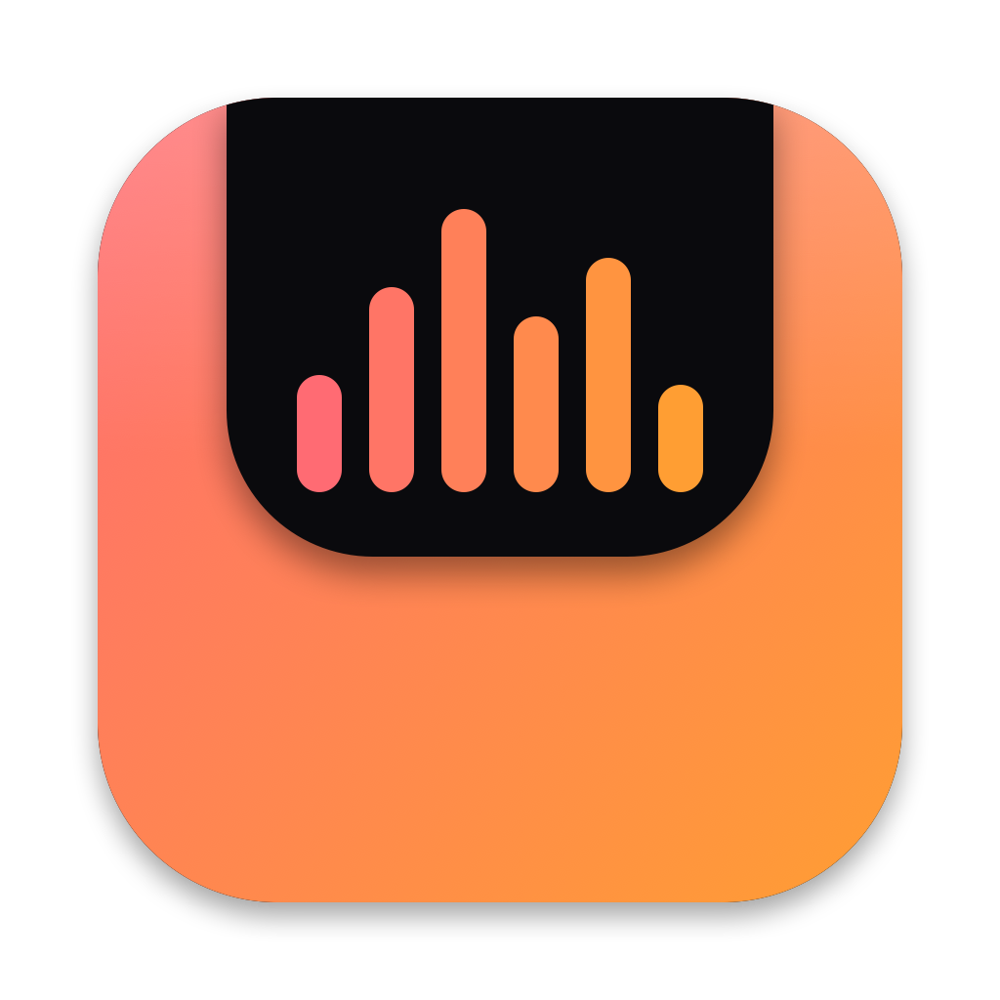

<div align="center">



# 💊 Pillbox

**A notch island for macOS: music, timers, clipboard, files and system alerts, one hover away.**

[](https://www.swift.org/)
[](https://www.apple.com/macos/)
[](https://developer.apple.com/xcode/swiftui/)

</div>

**Pillbox** turns the notch of your MacBook into a small control centre. Hover it and it opens into tabs for what is playing, your timers, your clipboard history, a shelf for files and your pinned apps. Collapsed, it shows live activity on both sides and pops short islands for events such as a download finishing or the battery reaching a level. On Macs and monitors without a notch it becomes a virtual pill at the top of the screen.

> [!NOTE]
> Pillbox runs entirely on your Mac: no account, no analytics. The only network calls are the lyrics lookup (LRCLIB) and the optional local developer API, which listens on `127.0.0.1` only.

## ✨ Features

### 🏝️ Island

- **Hover to open**, auto-close when the pointer leaves, adjustable delay. A flick to the top edge counts.
- **Tabs**: Home, Music, Timer, Stocks, AI usage, Notes, Clipboard, Shelf, Launcher, Terminal. Switch with ⌘1–9 or a two-finger swipe.
- **Live wings** on the collapsed pill: album art and equalizer, running timer, keep-awake countdown, microphone and camera dots, a pinned stock.
- **Activity islands**: short messages in place of the pill, with an optional action button.
- **Any Mac**: virtual pill with an adjustable width when there is no hardware notch.

### 🎵 Music

- **Spotify and Apple Music**: title, artist, artwork, seek, previous / play / next.
- **Synced lyrics** from LRCLIB, the current line shown under the title.

### ⏱️ Timer

- **Focus, break, countdown and stopwatch**, all wall-clock based so they never drift.
- **Chaining** focus into break, named timers, repeat, daily streak and a 7-day chart.

### 📋 Clipboard

- **History** with pins, search and a cap that never drops pinned items.
- **Smart cards** for links, hex colours and emails, with character and word counts for long text.
- **OCR** (Vision) of copied images, so search finds words inside screenshots.
- **Double-click to paste** into the front app. Concealed items from password managers are skipped.

### 🗂️ Shelf and apps

- **File shelf**: drop files on the notch, or drag a file toward it and it opens. Drag items back out later. Items survive relaunches.
- **Shelf actions**: AirDrop, zip and unzip (native `ditto`), reveal in Finder.
- **Launcher**: pin apps, reorder by dragging.
- **Notes**: a quick checklist that stays in the pill.

### 📈 Stocks and weather

- **Watchlist** with day sparklines and pre-market, open, after-hours and closed states (Yahoo Finance).
- **Price alerts** at ±2 % or ±5 % of the current price, and one symbol pinned to the collapsed pill.
- **Weather** on Home from Open-Meteo, using your location (Celsius or Fahrenheit following your region).

### 🤖 AI tools

- **AI usage**: tokens for the last 5 hours, today and 7 days, for **Claude Code** (`~/.claude/projects`) and **Codex** (`~/.codex/sessions`), read from the local logs. For Codex the limit window the CLI reports (percent used, reset time) is shown too. Nothing leaves the Mac, and cache reads are not counted.
- **Terminal**: a real xterm-compatible login shell in its own tab ([SwiftTerm](https://github.com/migueldeicaza/SwiftTerm)). It keeps running when you switch tabs and restarts if you exit it.
- **Long commands**: **Settings › Developer API › Copy zsh hook** gives an opt-in `preexec` / `precmd` snippet that shows an island when a command ran for 15 seconds or more.
- **Agent approvals**: when Claude Code is about to run a tool, an Allow / Deny island appears and your answer goes back through a `PreToolUse` hook. *Ask in terminal*, or two minutes without an answer, hands the decision back to Claude Code's normal prompt. Enable the local API, then **Settings › Developer API › Copy Claude Code approval hook** and paste the result into `~/.claude/settings.json`.

### 🔔 Alerts and tools

- **Battery**: plugged in, unplugged, charged at a level you choose (80–100 %), low battery.
- **Downloads**: an island with a Reveal button when a file lands in Downloads, whatever the browser.
- **Privacy indicator**: dots on the pill while any app uses the microphone or the camera.
- **Volume** island with a level bar, **Caps Lock** island.
- **Keystrokes** (off by default): shows the shortcuts you press, or everything you type if you turn *Shortcuts only* off. Never shown while macOS secure input is on (password fields), never stored.
- **Mic mute**: one switch mutes the input device itself, so every call app goes silent.
- **Camera mirror**: a local preview under the notch. Nothing is recorded.
- **Cleaning**: lock the keyboard for 60 s (⌘⎋ unlocks) or black out the displays.
- **Window snapping**: halves, thirds, centre and full screen from the command palette.
- **Keep awake**: indefinite or for a set duration.
- **Colour eyedropper** (HEX copied), **area screenshot** to the clipboard.
- **Home**: clock, next calendar event, CPU, memory and battery gauges.

### ⌨️ Command palette

`⌃⌥K` opens it from anywhere: jump to a tab, toggle keep awake, start a timer, pick a colour, search the clipboard and paste, or type a calculation.

### 🔗 Developer API

Off by default. When enabled in **Settings**, scripts and CI can show a message in the notch:

```bash
curl -X POST http://127.0.0.1:9998/notify \
  -H "Authorization: Bearer <token>" \
  -d '{"title":"Build done","message":"main passed","symbol":"hammer.fill","duration":4}'
```

`POST /approve` takes a Claude Code hook payload and answers with its decision (see AI tools). The token is generated per install (**Settings › Developer API › Copy example request**). Titles are limited to 120 characters, messages to 500, durations to 1–10 seconds.

## ⌨️ Default shortcuts

| Shortcut | Action |
| --- | --- |
| `⌃⌥K` | Command palette |
| `⌃⌥N` | Toggle the notch |
| `⌘1`–`⌘9` | Switch tab while the notch is open |

## 🛠️ Scripts

| Command | Description |
| --- | --- |
| `./build.sh` | Builds `build/Pillbox.app`. |
| `./scripts/ci.sh` | Builds, then runs the self-test: the same checks as CI. |
| `build/Pillbox.app/Contents/MacOS/Pillbox --selftest` | Non-interactive checks (parsers, maths, timers, stores, shelf zip, usage scan, island geometry, approvals) against a throwaway data folder. |
| `build/Pillbox.app/Contents/MacOS/Pillbox --usage` | Prints the Claude Code and Codex usage scan and how long it took. |
| `build/Pillbox.app/Contents/MacOS/Pillbox --open-tab <tab>` | Opens the notch on a tab and keeps it open (`home`, `music`, `timer`, `stocks`, `ai`, `notes`, `clipboard`, `shelf`, `launcher`, `terminal`). |
| `swift Resources/make_icon.swift <out.png>` | Renders the 1024 px app icon. |

## 🔐 Permissions

Pillbox asks for nothing at launch. **Settings › Permissions** (opened on first launch) shows the state of each one with an **Allow** button that triggers the system prompt, or **Open Settings** once macOS has refused.

| Permission | Used by | Why |
| --- | --- | --- |
| Automation (Spotify, Music) | Music | Read the current track and send transport commands. |
| Calendars | Home | Show the next event. |
| Location | Home | Local weather. |
| Camera | Camera mirror | Show the preview. |
| Input Monitoring | Keystroke display | Observe key presses system-wide. |
| Accessibility | Keyboard lock, window snapping, clipboard paste | Block keys, move windows, send ⌘V. |
| Downloads folder | Download alerts | Notice finished downloads. |

## 🧱 Technology stack

| Area | Technologies |
| --- | --- |
| Language | Swift (Swift Package, no Xcode project) |
| Dependencies | [SwiftTerm](https://github.com/migueldeicaza/SwiftTerm) (MIT) for the terminal tab |
| User interface | SwiftUI (island, tabs, settings), AppKit (borderless panel, hover and drag monitors) |
| Media | AppleScript for Spotify and Music, LRCLIB for lyrics, AVFoundation (camera mirror) |
| Web data | Open-Meteo (weather), Yahoo Finance (quotes) |
| System | IOKit (battery, keep awake), Mach (CPU and memory), CoreAudio and CoreMediaIO (volume, mic, camera), EventKit, CoreLocation, Network.framework, Accessibility |
| Recognition | Vision (clipboard OCR) |
| Persistence | JSON files in Application Support, `UserDefaults` for settings |

## 📦 Installation

### Build from source

You need macOS 14 or later and [Xcode](https://developer.apple.com/xcode/) with its command-line tools.

```bash
git clone <repository-url>
cd Pillbox
./build.sh        # -> build/Pillbox.app
open build/Pillbox.app
```

> [!TIP]
> `build.sh` signs ad hoc by default, so macOS asks for the permissions again after each rebuild. Set `PILLBOX_SIGN_IDENTITY` to a self-signed code-signing certificate to keep them.

## 📂 Project structure

```text
Pillbox/
├── Package.swift          # Swift Package, one executable target
├── build.sh               # Builds and signs build/Pillbox.app
├── Resources/             # Info.plist, app icon and its generator
├── scripts/               # ci.sh, claude-hook.sh (Claude Code approval hook)
├── .github/workflows/     # CI
└── Sources/Pillbox/
    ├── main.swift, AppDelegate.swift    # Entry point, menu bar, hover and drag monitors
    ├── NotchModel, NotchPanel           # State, geometry, click-through panel
    ├── NotchView, Tabs                  # Island, wings, activities, tab views
    ├── Music, Timers, Clipboard, Shelf  # Feature services
    ├── System.swift                     # Keep awake, battery, stats, downloads, tools, calendar
    ├── Stores.swift                     # Notes and launcher
    ├── Audio, Mirror, Cleaning, WindowSnap  # Volume, mic, privacy, camera, locks, snapping
    ├── Weather, Stocks, AIUsage         # Weather, watchlist, Claude Code and Codex usage
    ├── Terminal, Keystrokes             # Shell tab, keystroke display
    ├── Permissions.swift                # Permissions center
    ├── SelfTest.swift                   # Behind --selftest
    ├── Palette, Settings, DevAPI        # Command palette, hotkeys, settings, local API
```

## 💾 Local data

| What | Where |
| --- | --- |
| Settings | `UserDefaults` (bundle identifier `dev.labs.pillbox`) |
| Clipboard, shelf, notes, launcher, sessions, watchlist | `~/Library/Application Support/Pillbox` |

## 🗺️ Roadmap

Brightness HUD, call and message islands, Cursor and Copilot usage, drag-to-notch snap zones, desktop and lock-screen widgets, localisation.

## 🙌 Contributing

Issues and pull requests are welcome. Run `./scripts/ci.sh` first, and extend `Sources/Pillbox/SelfTest.swift` for anything testable without a screen. Commit with [Conventional Commits](https://www.conventionalcommits.org/) and keep pull requests focused.
